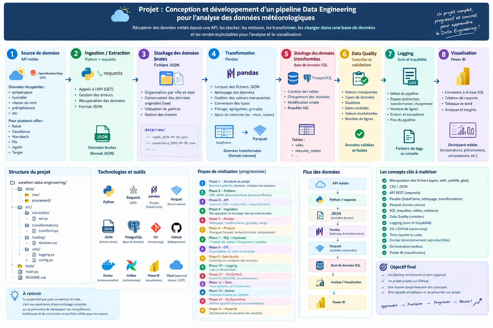

# Weather Data Engineering

Pipeline ETL de bout en bout pour les données météorologiques : extraction depuis l'API **Open-Meteo**, stockage brut en JSON, nettoyage et transformation avec **Pandas**, contrôles qualité, export **Parquet / CSV** et chargement dans **PostgreSQL** selon un modèle en étoile.

## Architecture

```
API Open-Meteo
      │  (requests)
      ▼
data/raw/ (JSON, un fichier par ville)
      │  (Pandas : nettoyage, colonnes dérivées, jointure région)
      ▼
Contrôles qualité  ──► échec : le pipeline s'arrête, erreur journalisée
      │
      ▼
data/processed/ (Parquet, CSV)  +  PostgreSQL (table meteo)
```



## Technologies

| Outil | Usage |
|---|---|
| Python 3 | langage principal |
| requests | appel à l'API REST Open-Meteo |
| Pandas, PyArrow | transformation, export Parquet |
| PostgreSQL 18 | entrepôt de données |
| SQLAlchemy, psycopg2 | connexion Python → PostgreSQL |
| python-dotenv | gestion des identifiants (`.env`) |
| logging | journalisation dans `logs/pipeline.log` |

## Structure du projet

```
weather-data-engineering/
├── data/
│   ├── raw/                # données brutes (JSON), jamais modifiées
│   └── processed/          # données nettoyées (Parquet, CSV)
├── docs/                   # schémas et documentation
├── notebooks_apprentissage/# scripts d'essai de la phase d'apprentissage
├── src/
│   ├── config.py           # chemins, URL de l'API, villes, nombre de jours
│   ├── extract.py          # E : appel API, sauvegarde dans raw/
│   ├── transform.py        # T : nettoyage, colonnes dérivées, jointure région
│   ├── quality.py          # contrôles qualité avant chargement
│   ├── load.py             # L : Parquet, CSV, PostgreSQL
│   └── logger.py           # configuration des logs
├── logs/                   # pipeline.log (non versionné)
├── main.py                 # point d'entrée : orchestre E, T, Q, L
├── requirements.txt
├── .env.example            # modèle de configuration
└── README.md
```

## Installation

1. Cloner le dépôt :
   ```bash
   git clone https://github.com/Hajar444238/weather-data-engineering.git
   cd weather-data-engineering
   ```
2. Installer les dépendances :
   ```bash
   pip install -r requirements.txt
   ```
3. Installer PostgreSQL et créer la base `weather_db`.
4. Copier `.env.example` en `.env`, puis renseigner vos propres valeurs :
   ```
   DB_USER=postgres
   DB_PASSWORD=votre_mot_de_passe
   DB_HOST=localhost
   DB_PORT=5432
   DB_NAME=weather_db
   ```
   Le fichier `.env` n'est jamais versionné (il est dans `.gitignore`).

## Utilisation

Lancer le pipeline **depuis la racine du projet** :

```bash
python main.py
```

Le pipeline exécute dans l'ordre : extraction, transformation, contrôles qualité, puis chargement. Chaque étape est journalisée dans le terminal et dans `logs/pipeline.log` :

```
2026-11-07 14:33:55 | INFO | WeatherPipeline | Demarrage du pipeline Weather Data Engineering
2026-11-07 14:33:58 | INFO | WeatherPipeline | Qualite des donnees suffisante
2026-11-07 14:33:59 | INFO | WeatherPipeline | Pipeline termine avec succes
```

## Données

- **Source** : API Open-Meteo (gratuite, sans clé), prévisions horaires sur 3 jours.
- **Villes** : Rabat, Casablanca, Tanger.
- **Variables** : température (`temperature_2m`) et humidité relative (`relative_humidity_2m`).
- **Volume** : 3 villes × 3 jours × 24 h = 216 lignes par exécution.

Colonnes dérivées : `date`, `heure`, `chaud` (température > 25 °C), `periode` (moment de la journée) et `region`.

## Modèle de données

Modèle en étoile dans PostgreSQL :

| Table | Rôle | Colonnes principales |
|---|---|---|
| `meteo` | table de faits | ville, date, heure, température, humidité |
| `villes` | dimension | ville (PK), region |
| `dim_date` | dimension | date_ (PK), jour, mois |

## Contrôles qualité

Avant tout chargement, `verifier_qualite()` renvoie la liste des anomalies. Si elle n'est pas vide, le pipeline s'arrête et rien n'est chargé.

| Contrôle | Ce qui est détecté |
|---|---|
| Valeurs manquantes | trous dans les données |
| Doublons | lignes répétées |
| Plages de valeurs | température hors [-10, 50] °C, humidité hors [0, 100] % |
| Nombre de lignes | écart avec `villes × jours × 24` |
| Type de date | colonne `time` qui n'est pas de type datetime |

## Limites et améliorations prévues

- Le chargement PostgreSQL utilise `if_exists="replace"` : la table est recréée à chaque exécution, donc sans doublon mais sans historique. **À venir** : chargement incrémental.
- La colonne `region` est présente à la fois dans `meteo` et dans `villes` : à retirer de la table de faits.
- Ajouter d'autres villes (il suffit de compléter `VILLES` dans `config.py`).
- Tests automatisés, conteneurisation (Docker), orchestration (Airflow) et tableau de bord (Tableau / Power BI).

## Licence

Projet sous licence MIT.
